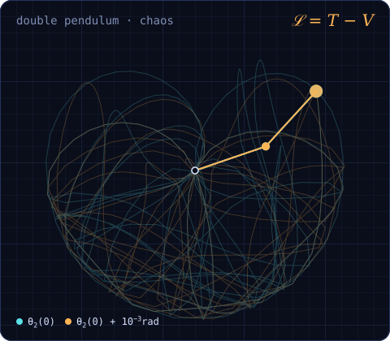
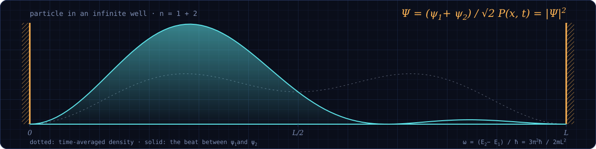

<!-- if you're reading the source: hi 👋 every graphic on this page is computed, not drawn. see scripts/build_assets.py -->

<p align="center">
  
</p>

<h3 align="center">A lifelong learner, deep in machine learning &amp; simulation.</h3>

<p align="center">
  <sub>driven by curiosity · passionate about complex problems · committed to continuous growth</sub>
</p>

<p align="center">
  <a href="mailto:rabin@ruhrbin.site"><code>✉ rabin@ruhrbin.site</code></a>
  &nbsp;
  <a href="https://x.com/RuHRabin"><code>𝕏 @RuHRabin</code></a>
</p>

<p align="center"></p>

## `∅` Abstract

I like taking things apart to see how they actually work. Most days that means a machine learning experiment or a simulation: the "let's see what happens" kind of programming, not the roadmap-driven kind. I pull something apart, break it, and figure out how to put it back together, usually better than it started.

<p align="center"></p>

## `ħ` Constants

| symbol | observable | value |
| :-: | :-- | :-- |
| `Φ` | focus | machine learning, simulation |
| `∇` | method | take it apart → break it → rebuild it better |
| `λ` | style | "let's see what happens", not roadmap-driven |
| `Ψ` | status | 🎯 Focusing |
| `?` | ask me about | science, tech |

<p align="center"></p>

## `∂` Chaos &amp; order

<table>
  <tr>
    <td width="50%"></td>
    <td width="50%"></td>
  </tr>
  <tr>
    <td align="center"><sub><b>chaos</b> · one part in a thousand changes the whole future</sub></td>
    <td align="center"><sub><b>order</b> · equal areas in equal times, and <code>T² ∝ a³</code></sub></td>
  </tr>
</table>

Rules in, surprising behaviour out. Simulation is where I go to ask *"what if?"* and let the answer surprise me. Same equations, nudged by a thousandth of a radian, and the pendulum forgets where the other one went. Same equations, no nudge needed, and a planet keeps its books balanced forever.

<p align="center"></p>

## `∇` Descent

Nature picks the path that makes the action stationary. A model picks the weights that make the loss small. I like that these are the same sentence in different notation.

$$
\delta S = 0 \;\Longleftrightarrow\; \frac{d}{dt}\frac{\partial \mathcal{L}}{\partial \dot q} - \frac{\partial \mathcal{L}}{\partial q} = 0
\qquad\qquad
\theta_{k+1} = \theta_k - \eta\,\nabla_\theta L(\theta_k)
$$

<p align="center"><sub>physics: least action &nbsp;·&nbsp; machine learning: gradient descent &nbsp;·&nbsp; both: walk downhill until nothing changes</sub></p>

<p align="center"></p>

## `ψ` Superposition

<p align="center">
  
</p>

<p align="center"><sub>questions go in · experiments and mistakes reshape the state · understanding comes out</sub></p>

Before I look, an idea is a superposition of every way it could be wrong. Experiments collapse it.

<p align="center"></p>

## `Σ` Registry

<sub>Measured straight from GitHub by a small script. Publish or update a repo and this table re-solves itself.</sub>

<!--STATS:START-->
`N = 14` systems &nbsp;·&nbsp; `Σ★ = 11` &nbsp;·&nbsp; `basis = {HTML, JavaScript, Kotlin, Python, Shell, TypeScript}`
<!--STATS:END-->

<!--PINNED:START-->
| system | what it does | basis | ★ | last perturbed |
| :-- | :-- | :-- | --: | :-- |
| [**earthpulse**](https://github.com/RuHRabin/earthpulse) | <sub>no description yet</sub> | `JavaScript` | 2 | 2026-10-18 |
| [**xkb-avro**](https://github.com/RuHRabin/xkb-avro) | Native XKB keyboard layout for Bengali Avro Phonetic on Linux — no IBus, no Fcitx, no daemon required. | `Shell` | 1 | 2026-06-15 |
| [**Gargantua**](https://github.com/RuHRabin/Gargantua) | A browser game inspired by Interstellar. Fly a small ship around a black hole, collect data, and get back to… | `TypeScript` | 0 | 2026-10-12 |
<!--PINNED:END-->

## `⟳` Recent events

<!--RECENT:START-->
- `t = 2026-10-18` &nbsp;⟶&nbsp; [ruhrabin.github.io](https://github.com/RuHRabin/ruhrabin.github.io) · `HTML`
- `t = 2026-10-18` &nbsp;⟶&nbsp; [Sol-Mesh](https://github.com/RuHRabin/Sol-Mesh) · `Kotlin`
- `t = 2026-10-18` &nbsp;⟶&nbsp; [earthpulse](https://github.com/RuHRabin/earthpulse) · `JavaScript`
- `t = 2026-10-15` &nbsp;⟶&nbsp; [3D-Website-Boilerplate-Designer-Doc](https://github.com/RuHRabin/3D-Website-Boilerplate-Designer-Doc) · `HTML`
- `t = 2026-10-13` &nbsp;⟶&nbsp; [Schemify](https://github.com/RuHRabin/Schemify) · `Python`
<!--RECENT:END-->

<p align="center"></p>

## `⚙` Toolchain

```toml
# toolchain.toml
[language]   python · bash
[ml]         pytorch · tensorflow · scikit-learn
[system]     linux · git · github · anaconda
```

## `⟶` Signal

Ask me about **science** and **tech**.

- ✉ &nbsp;[rabin@ruhrbin.site](mailto:rabin@ruhrbin.site)
- 𝕏 &nbsp;[@RuHRabin](https://x.com/RuHRabin)
- Facebook &nbsp;[RuHRabin](https://www.facebook.com/RuHRabin)

<br>

<p align="center">
  <code>∂(loss)/∂t &lt; 0 &nbsp;·&nbsp; ∂(curiosity)/∂t &gt; 0 &nbsp;·&nbsp; still training</code>
</p>

<p align="center">
  <sub>Lorenz and the pendulums by RK4 · Kepler by Newton's method · the well from its exact eigenstates · <a href="scripts/build_assets.py">see the code</a></sub>
</p>
