<!-- if you're reading the source: hi 👋 everything on this page is hand-built, nothing is a template. -->

<p align="center">
  
</p>

<h3 align="center">A lifelong learner, deep in machine learning &amp; simulation.</h3>

<p align="center">
  <sub>driven by curiosity · passionate about complex problems · committed to continuous growth</sub>
</p>

<br>

## `00` · Initialization

I like taking things apart to see how they actually work. Most days that means a machine learning experiment or a simulation: the "let's see what happens" kind of programming, not the roadmap-driven kind. I pull something apart, break it, and figure out how to put it back together, usually better than it started.

<br>

## `01` · Hyperparameters

| parameter | value |
| :-- | :-- |
| `focus` | machine learning, simulation |
| `optimizer` | take it apart → break it → rebuild it better |
| `style` | "let's see what happens", not roadmap-driven |
| `status` | 🎯 Focusing |
| `ask_me_about` | science, tech |

<br>

## `02` · Architecture

<p align="center">
  
</p>

<p align="center"><sub>questions go in · experiments and mistakes reshape the weights · understanding comes out</sub></p>

<br>

## `03` · Simulation

<p align="center">
  
</p>

Rules in, surprising behaviour out. Simulation is where I go to ask *"what if?"* and let the answer surprise me.

<br>

## `04` · Model registry

<sub>Pulled straight from GitHub by a small script. Publish or update a repo and this table follows on its own.</sub>

<!--STATS:START-->
`public_repos = 14` &nbsp;·&nbsp; `stars_earned = 12` &nbsp;·&nbsp; `languages = HTML, JavaScript, Kotlin, Python, Shell, TypeScript`
<!--STATS:END-->

<!--PINNED:START-->
| project | what it does | language | ★ | last updated |
| :-- | :-- | :-- | --: | :-- |
| [**earthpulse**](https://github.com/RuHRabin/earthpulse) | <sub>no description yet</sub> | `JavaScript` | 3 | 2026-10-18 |
| [**xkb-avro**](https://github.com/RuHRabin/xkb-avro) | Native XKB keyboard layout for Bengali Avro Phonetic on Linux — no IBus, no Fcitx, no daemon required. | `Shell` | 1 | 2026-06-15 |
| [**Gargantua**](https://github.com/RuHRabin/Gargantua) | A browser game inspired by Interstellar. Fly a small ship around a black hole, collect data, and get back to… | `TypeScript` | 0 | 2026-10-12 |
<!--PINNED:END-->

<br>

## `05` · Recent runs

<!--RECENT:START-->
- `2026-10-18` &nbsp;[Sol-Mesh](https://github.com/RuHRabin/Sol-Mesh) · `Kotlin`
- `2026-10-18` &nbsp;[earthpulse](https://github.com/RuHRabin/earthpulse) · `JavaScript`
- `2026-10-18` &nbsp;[ruhrabin.github.io](https://github.com/RuHRabin/ruhrabin.github.io) · `HTML`
- `2026-10-15` &nbsp;[3D-Website-Boilerplate-Designer-Doc](https://github.com/RuHRabin/3D-Website-Boilerplate-Designer-Doc) · `HTML`
- `2026-10-13` &nbsp;[Schemify](https://github.com/RuHRabin/Schemify) · `Python`
<!--RECENT:END-->

<br>

## `06` · Environment

```text
# requirements.txt
python
linux
bash
git
github
tensorflow
pytorch
scikit-learn
anaconda
```

<br>

## `07` · Inference

Ask me about **science** and **tech**.

- 𝕏 &nbsp;[@RuHRabin](https://x.com/RuHRabin)
- Facebook &nbsp;[M.RakibUlHasanRabin](https://www.facebook.com/M.RakibUlHasanRabin)

<br>

<p align="center">
  <sub><code>loss ↓ &nbsp;·&nbsp; curiosity ↑ &nbsp;·&nbsp; still training</code></sub>
</p>
