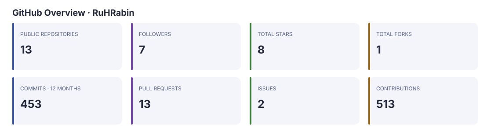
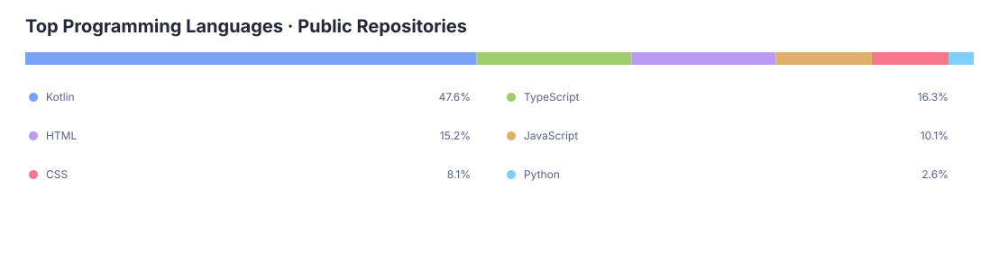
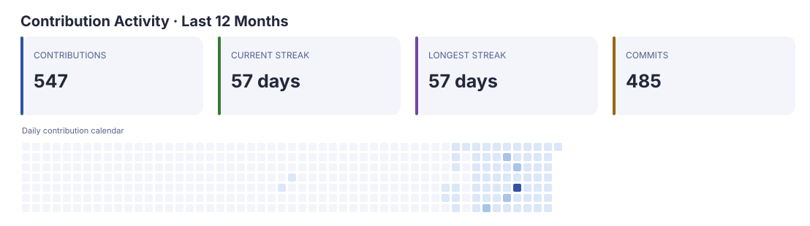
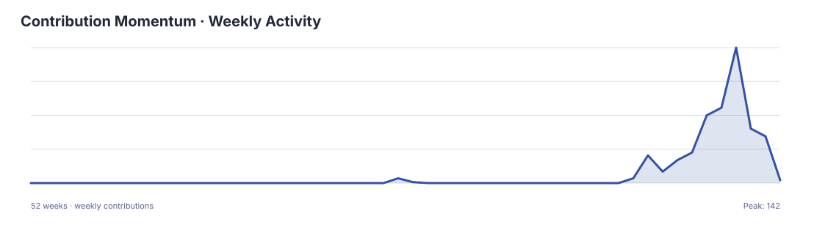

# Rabin

I build things to understand how they work. My current interests are **machine learning, physics simulations, and practical software experiments**.

- **Working on:** ML experiments, interactive simulations, and small tools
- **Interested in:** Python, Linux, scientific computing, and the web
- **Website:** [ruhrbin.site](https://ruhrbin.site)
- **Contact:** [rabin@ruhrbin.site](mailto:rabin@ruhrbin.site)
- **X:** [@RuHRabin](https://x.com/RuHRabin)

## Tools

**Core:** Python · Linux · Bash · Git

**Exploring:** PyTorch · TensorFlow · scikit-learn · JavaScript · TypeScript · React · Three.js · Kotlin

## GitHub activity

These cards are generated from GitHub data and refreshed automatically.

<picture>
  <source media="(prefers-color-scheme: dark)" srcset="assets/overview.dark.svg">
  
</picture>

<picture>
  <source media="(prefers-color-scheme: dark)" srcset="assets/languages.dark.svg">
  
</picture>

<picture>
  <source media="(prefers-color-scheme: dark)" srcset="assets/contributions.dark.svg">
  
</picture>

<picture>
  <source media="(prefers-color-scheme: dark)" srcset="assets/momentum.dark.svg">
  
</picture>

## Find me

[Website](https://ruhrbin.site) · [GitHub](https://github.com/RuHRabin) · [X](https://x.com/RuHRabin) · [Email](mailto:rabin@ruhrbin.site)
