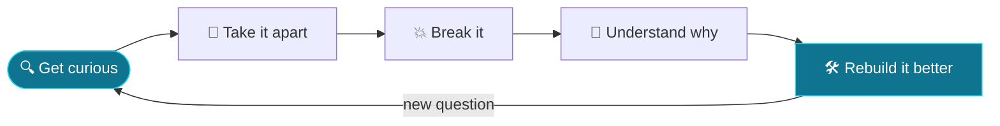

<!-- ═══════════════════════════════════════════════════════════════
     RuHRabin · profile README
     Self-contained: no local assets or workflows needed.
     Everything loads from public badge / card services.
     ═══════════════════════════════════════════════════════════════ -->

<div align="center">


<a href="https://github.com/RuHRabin/RuHRabin">
  
</a>

<br/>

<a href="https://rabin.pro.bd"></a>
<a href="mailto:contact@rabin.pro.bd"></a>
<a href="https://x.com/RuHRabin"></a>
<a href="https://www.facebook.com/M.RakibUlHasanRabin"></a>

<br/><br/>


</div>

<br/>

---

## `~/whoami`

```python
class Rabin:
    status    = "Focusing 🎯"
    mode      = "lifelong learner"
    deep_in   = ["machine learning", "simulation"]
    method    = "take it apart → break it → rebuild it better"
    style     = "'let's see what happens' programming, not roadmap-driven"
    ask_me    = ["science", "tech"]
    reach_me  = "contact@rabin.pro.bd"

    def run(self):
        while self.curious:
            self.experiment()
            self.learn()
```

<sub>Most days that means a machine learning experiment or a simulation. I pull something apart, break it, and work out how to put it back together, usually better than it started.</sub>

<br/>

## ⟲ The loop I live in



<br/>

## 🧰 Tools I reach for

<div align="center">


</div>

<br/>

## 📌 Pinned

<div align="center">

<a href="https://github.com/RuHRabin/Remove-Metadata-from-image-and-videos-on-Linux-">
  
</a>

</div>

### 🛡️ Featured: privacy, offline, no strings attached

> **[Remove-Metadata-from-image-and-videos-on-Linux-](https://github.com/RuHRabin/Remove-Metadata-from-image-and-videos-on-Linux-)**
> A ready-to-run list of commands for stripping metadata from images and videos on Linux. Every tool is free, open source and works fully offline, so your files never leave your machine.

<br/>

## 📊 By the numbers

<div align="center">


</div>

<br/>

## 🧪 Lab notebook

<details>
<summary><b>Click to peek at a typical training run</b></summary>

<br/>

```text
epoch 01 │ loss ████████████████████ 2.48 │ curiosity ██████████████████████ 99%
epoch 02 │ loss ██████████████░░░░░░ 1.71 │ curiosity ██████████████████████ 99%
epoch 03 │ loss █████████░░░░░░░░░░░ 1.02 │ curiosity ██████████████████████ 99%
epoch 04 │ loss █████░░░░░░░░░░░░░░░ 0.58 │ curiosity ██████████████████████ 99%
epoch 05 │ loss ██░░░░░░░░░░░░░░░░░░ 0.19 │ curiosity ██████████████████████ 99%
   ↳ model converged. curiosity did not. (working as intended.)
```

<sub>Illustrative, not a real log. The one constant across every run is the second column.</sub>

</details>

<details>
<summary><b>Things I'm happy to talk about</b></summary>

<br/>

| Topic | Why it pulls me in |
| :-- | :-- |
| 🤖 Machine learning | Watching a model learn a pattern nobody wrote down |
| 🌀 Simulation | Rules go in, surprising behaviour comes out |
| 🔬 Science | The best way to be wrong in an interesting way |
| 🐧 Linux & open source | Tools you can take apart and trust |
| 🔐 Privacy | Your data, your machine, your rules |

</details>

<br/>

## 📬 Let's connect

Got a question about science or tech, an experiment worth breaking, or a project that needs fresh eyes? Reach out.

<div align="center">

**[rabin.pro.bd](https://rabin.pro.bd)** &nbsp;·&nbsp; **[contact@rabin.pro.bd](mailto:contact@rabin.pro.bd)** &nbsp;·&nbsp; **[@RuHRabin](https://x.com/RuHRabin)**

<br/>

<sub>More on <a href="https://github.com/RuHRabin?tab=repositories">GitHub</a> &nbsp;·&nbsp; MIT licensed &nbsp;·&nbsp; still learning, always.</sub>


</div>
