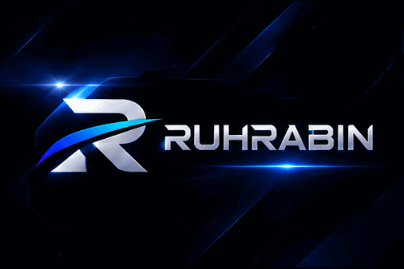

# Hey, I'm Rabin 👋

<picture>
  
</picture>

### I build things to understand how they work.

**Machine learning · Physics simulations · Practical software experiments**

[Website](https://ruhrbin.site) · [GitHub](https://github.com/RuHRabin) · [X](https://x.com/RuHRabin) · [Email](mailto:rabin@ruhrbin.site)

---

## About

I'm Rabin. I enjoy taking things apart, understanding the ideas behind them, and turning what I learn into working software.

My current interests sit around **machine learning, scientific computing, physics simulations, Linux, and the web**. I like practical experiments that connect theory with code—whether that's exploring a model, simulating a system, or building something interactive.

I don't have a project showcase to pin here yet. I'm learning, experimenting, and building toward one.

## Tools & technologies

**What I work with**

`Python` · `C` · `Bash` · `Git` · `Linux` · `AI`

**What I'm exploring**

`PyTorch` · `TensorFlow` · `scikit-learn` · `JavaScript` · `TypeScript` · `React` · `Three.js` · `Kotlin`

I'm also interested in **AI-assisted development** and using vibe coding to prototype ideas, especially interactive and **3D experiences for the web**.

## What I'm curious about

- **Machine learning** — understanding models, experiments, and practical applications.
- **Physics simulations** — using code to explore how systems behave.
- **Scientific computing** — connecting mathematical ideas with useful programs.
- **Linux & systems** — learning what happens beneath the interfaces.
- **Creative web** — building interactive experiences, including 3D for the browser.

## Find me

- **Website:** [ruhrbin.site](https://ruhrbin.site)
- **X:** [@RuHRabin](https://x.com/RuHRabin)
- **Email:** [rabin@ruhrbin.site](mailto:rabin@ruhrbin.site)

---

*Stay curious. Build, break, understand, repeat.*

